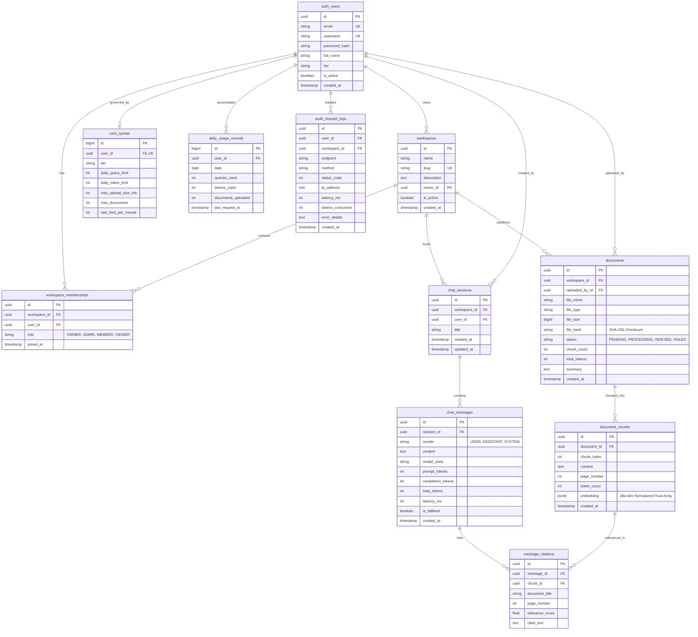

# FalconXoft AI SaaS Workspace — Database Design & ERD Specification
**Weekend 2 Intern Engineering Evaluation | Project 1**  
**Author:** Engineering Evaluation Candidate  
**Target Engine:** PostgreSQL 18.3 (ACID-Compliant Relational Store)  
**Schema Dump File:** [`03 - schema.sql`](./03%20-%20schema.sql) (1,349 lines of executable DDL)  
**Lucidchart Editable URL Reference:** [https://lucid.app/lucidchart/461d616a-0e24-427c-b3ff-982f809db8ea/edit?viewport_loc=-852%2C112%2C4776%2C2316%2C0_0&invitationId=inv_a714faba-a61b-4cb5-b1fd-687c6c5d68f9](https://lucid.app/lucidchart/461d616a-0e24-427c-b3ff-982f809db8ea/edit?viewport_loc=-852%2C112%2C4776%2C2316%2C0_0&invitationId=inv_a714faba-a61b-4cb5-b1fd-687c6c5d68f9)  
**Exported Artifacts:** [`03 - database-design.png`](./03%20-%20database-design.png) | [`03 - database-design.pdf`](./03%20-%20database-design.pdf)

---

## 1. Entity-Relationship Diagram (Mermaid ERD)

---

## 2. Table Specifications, Constraints & Indexing Strategy

### Table: `workspaces` (Multi-Tenant Partition Root)
- **Primary Key**: `id` (`UUID DEFAULT gen_random_uuid()`)
- **Fields**:
  - `name VARCHAR(150) NOT NULL`
  - `slug VARCHAR(180) UNIQUE NOT NULL` (indexed)
  - `description TEXT DEFAULT ''`
  - `owner_id UUID NOT NULL REFERENCES auth_users(id) ON DELETE CASCADE`
  - `is_active BOOLEAN DEFAULT TRUE`
  - `created_at TIMESTAMP WITH TIME ZONE DEFAULT NOW()`
- **Indexes**:
  - `workspaces_slug_idx` ON `slug`
  - `workspaces_owner_idx` ON `owner_id`

### Table: `workspace_memberships` (RBAC Junction)
- **Primary Key**: `id` (`UUID`)
- **Fields**:
  - `workspace_id UUID REFERENCES workspaces(id) ON DELETE CASCADE`
  - `user_id UUID REFERENCES auth_users(id) ON DELETE CASCADE`
  - `role VARCHAR(20) NOT NULL CHECK (role IN ('OWNER', 'ADMIN', 'MEMBER', 'VIEWER'))`
  - `joined_at TIMESTAMP WITH TIME ZONE DEFAULT NOW()`
- **Constraints & Indexes**:
  - `UNIQUE (workspace_id, user_id)` — Guarantees a user cannot have duplicate memberships in the same workspace.

### Table: `documents` (Workspace Knowledge Artifacts)
- **Primary Key**: `id` (`UUID`)
- **Fields**:
  - `workspace_id UUID NOT NULL REFERENCES workspaces(id) ON DELETE CASCADE`
  - `uploaded_by_id UUID NULL REFERENCES auth_users(id) ON DELETE SET NULL`
  - `file VARCHAR(255) NOT NULL`
  - `file_name VARCHAR(255) NOT NULL`
  - `file_type VARCHAR(50) NOT NULL` (`pdf`, `docx`, `txt`, `md`)
  - `file_size BIGINT NOT NULL` (bytes)
  - `file_hash VARCHAR(64) NOT NULL` (SHA-256 hexadecimal string)
  - `status VARCHAR(20) NOT NULL DEFAULT 'PENDING'` (`PENDING`, `PROCESSING`, `INDEXED`, `FAILED`)
  - `chunk_count INT DEFAULT 0`
  - `total_tokens INT DEFAULT 0`
  - `error_message TEXT NULL`
  - `summary TEXT DEFAULT ''`
  - `created_at TIMESTAMP WITH TIME ZONE DEFAULT NOW()`
- **Compound Indexes for Multi-Tenant Query Optimization**:
  - `documents_workspace_status_idx` ON `(workspace_id, status)` — Optimizes RAG retrieval candidates.
  - `documents_workspace_hash_idx` ON `(workspace_id, file_hash)` — Instant O(1) deduplication lookup during upload.

### Table: `document_chunks` (Semantic Segment Store)
- **Primary Key**: `id` (`UUID`)
- **Fields**:
  - `document_id UUID NOT NULL REFERENCES documents(id) ON DELETE CASCADE`
  - `chunk_index INT NOT NULL`
  - `content TEXT NOT NULL`
  - `page_number INT NULL`
  - `token_count INT DEFAULT 0`
  - `embedding JSONB NULL` (384-dimensional normalized float array)
  - `created_at TIMESTAMP WITH TIME ZONE DEFAULT NOW()`
- **Indexes**:
  - `document_chunk_doc_idx` ON `(document_id, chunk_index)`

### Table: `daily_usage_records` (Quota Enforcement)
- **Primary Key**: `id` (`BIGINT GENERATED ALWAYS AS IDENTITY`)
- **Fields**:
  - `user_id UUID NOT NULL REFERENCES auth_users(id) ON DELETE CASCADE`
  - `date DATE NOT NULL`
  - `queries_used INT DEFAULT 0`
  - `tokens_used INT DEFAULT 0`
  - `documents_uploaded INT DEFAULT 0`
  - `last_request_at TIMESTAMP WITH TIME ZONE DEFAULT NOW()`
- **Constraints & Indexes**:
  - `UNIQUE (user_id, date)` — Eliminates race conditions in daily rollups.
  - `daily_usage_user_date_idx` ON `(user_id, date)`

---

## 3. Data Integrity & Concurrency Guarantees

1. **Multi-Tenant Boundary Enforcement**:
   - Every file read, chunk retrieval, and chat query enforces `WHERE workspace_id = :active_workspace`.
   - Users cannot join workspaces without an explicit invite/admin membership row.

2. **Deduplication via Cryptographic Hashing**:
   - Files are hashed via SHA-256 before disk writes. If `documents.objects.filter(workspace=ws, file_hash=hash).exists()`, the backend returns the existing document immediately, avoiding redundant re-chunking and vector re-indexing.

3. **Atomic Quota Updates & Concurrency**:
   - Quota tracking uses database transactions with Django `F()` expressions or atomic increments (`queries_used = queries_used + 1`) to prevent lost updates under concurrent API invocations.

4. **Executable Schema Dump**:
   - The full, executable PostgreSQL DDL dump is exported at [`03 - schema.sql`](./03%20-%20schema.sql) and validated against PostgreSQL 18.
